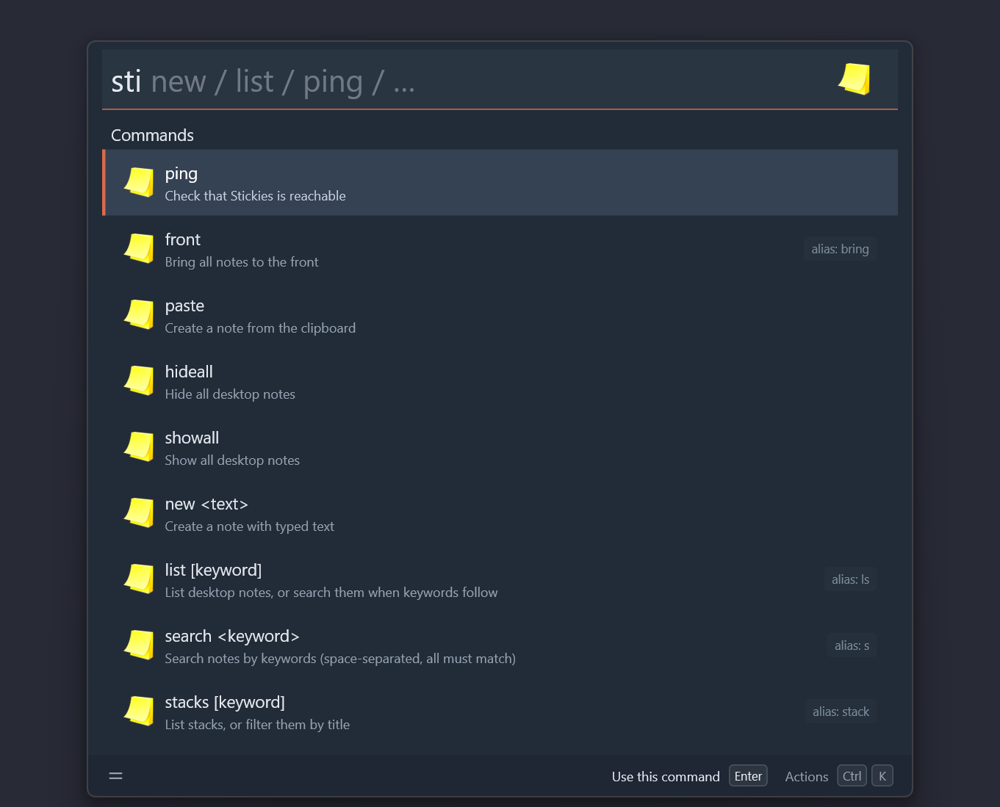

# Stickies

Create, browse, search and manage [Stickies](https://www.zhornsoftware.co.uk/stickies/index.html) notes from [Wox](https://www.woxlauncher.com/).



## Requirements

- Windows with Windows PowerShell 5.1, which ships with Windows 10 and 11.
- Wox 2.5.0 or newer.
- Stickies installed and running. The plugin talks to the running Stickies process and does not start it for you.

The plugin manages desktop notes only. Notes in the Closed category are not listed or searchable; restore them from Stickies Manage first.

## Install

```shell
wpm install Stickies
```

## Usage

Type the trigger keyword (`sti` by default), then a command:

Typing just the trigger keyword lists every command. Enter fills `new` and `search` with a trailing space, opens the `list`, `stacks` and `ping` views, and runs `paste`, `hideall`, `showall` and `front` immediately. If the plugin uses only the global `*` trigger, there is no concrete keyword to fill in, so only the runnable commands work from the help list.

| Command                                    | Action                                              |
| ------------------------------------------ | --------------------------------------------------- |
| `sti new <text>`                           | Create a desktop note with the text                 |
| `sti new`                                  | Create a blank note                                 |
| `sti list` / `sti ls`                      | List desktop notes                                  |
| `sti list <keyword>` / `sti ls <keyword>`  | Search notes, same as `search`                      |
| `sti search [keyword]` / `sti s [keyword]` | Search note titles and bodies; no keyword lists all |
| `sti paste`                                | Create a note from the clipboard as plain text      |
| `sti hideall` / `sti showall`              | Hide or show all desktop notes                      |
| `sti front` / `sti bring`                  | Bring all visible notes to the front                |
| `sti stacks` / `sti stack`                 | List stacks, or filter them by title                |
| `sti ping`                                 | Check that Stickies is running and show its version |

`sti front` raises every visible note above other windows, the same as clicking the Stickies tray icon; hidden notes stay hidden. Use `sti showall` first if you also want hidden notes back.

### Note actions

For a visible note that is not rolled up, Enter runs **Focus**: the note is brought to the front and receives keyboard focus. Hidden notes default to **Show**, and visible rolled notes to **Unroll**, so Enter always moves a note one step towards open: hidden → shown → unrolled → focused.

| Action                                       | Behaviour                                                                    |
| -------------------------------------------- | ---------------------------------------------------------------------------- |
| Focus                                        | Bring a visible, unrolled note to the front and give it keyboard focus       |
| Show / Hide                                  | Show a hidden note or hide a visible one                                     |
| Roll up / Unroll                             | Collapse the note to its title bar or expand it                              |
| Copy text                                    | Copy the note body to the clipboard                                          |
| Copy image                                   | Copy a pure image note's bitmap to the clipboard                             |
| Keep on top / Stop keeping on top            | Toggle the Stickies always-on-top flag                                       |
| Enable click-through / Disable click-through | Toggle ghost mode: the note stays visible but lets mouse clicks pass through |
| Close                                        | Move the note to the Closed category, restorable from Stickies Manage        |
| Delete permanently                           | Remove the note from Stickies; there is no confirmation and no undo          |

Notes that are rolled up, kept on top, click-through or pure images show `rolled`, `on top`, `click-through` or `image` tail labels in the list; the labels are localized in the Wox UI.

### Search

Search splits the query on whitespace and requires every keyword to appear in the note title or body (AND), so `sti list milk todo` and `sti search milk todo` both find notes containing both words. Matching is case-insensitive literal substring matching, so regex characters need no escaping.

`sti search` without keywords behaves like `sti list`. Only the first 30 desktop notes returned by Stickies are fetched, so notes beyond that limit are not listed or searched.

### Image notes

Pure image notes have no text body. They get an `image` tag, preview as `(image note, no text)` and offer **Copy image**. Search them with the image words for the active Wox language: `image`, `picture`, `photo` or `screenshot` in English, and `图片`, `照片`, `截图` or `图像` in Chinese.

A note that mixes text and an embedded image is listed with its text and does not offer **Copy image**, because the Stickies API only identifies pure image notes.

### Stacks

`sti stacks` lists every stack with its id, screen position, size, note count, shared colour (or a count of colours when members differ) and the latest modification time among its notes. A keyword after `stacks` filters by stack title; multiple keywords are ANDed and matching is case-insensitive.

Enter toggles the stack: collapsed notes are spread onto the desktop, and spread notes are collapsed back into the stack. Each row also has explicit **Collapse notes into the stack** and **Spread notes onto the desktop** actions.

The Stickies API cannot create, rename or delete stacks, and it does not expose whether a stack is currently collapsed. Membership is read through the undocumented `get desktop <id> stack` command: on a Stickies build that does not answer it, stacks still list normally, but the note count, colour and modified time are omitted. Only the first 30 stacks are listed.

### Creating notes and titles

`sti new <text>` creates a note with up to 4000 characters; longer input is truncated. `sti new` creates a blank note.

The **Title of new notes** setting controls the title for notes created by `new` and `paste`:

- **Follow Stickies setting**: leave the title untouched, so Stickies applies its own title option.
- **Blank**: clear the title.
- **Creation time**: set the local time in `YYYY-MM-DD HH:mm` format.
- **First line of text**: use the first line of the body, trimmed and limited to 80 characters. If the line is empty, the title is cleared.

Bare text such as `sti buy milk` is not created implicitly when a concrete trigger keyword is configured; the plugin offers to complete it as `sti new buy milk`. If the plugin is bound only to the global `*` trigger, there is no concrete prefix to complete, so bare text creates the note directly.

`sti paste` creates a note from the clipboard as plain text. Formatting, images and other clipboard formats are not preserved.

### Note preview and tags

Selecting a note shows metadata tags below the preview: screen position (`x,y`), window size (`WxH`), last modified time (`YYYY-MM-DD HH:mm`), background colour (`Grey #E6E6E6`, or just the hex value for colours outside Stickies' palette) and transparency (`90%`). Hover a tag to see which attribute it is.

Rolled notes report their title bar size, because that is what Stickies returns for a rolled window. Fully opaque notes (API value 0 or 100) omit the transparency tag. If a note has no title, the list shows the first line of its body; a note with neither title nor body shows `(no title)`, and a pure image note shows `(image note)`.

The `modified` value only tracks changes to a note's text, title, colour and similar fields. Moving, resizing, on-top, transparency, rolling up and ghost mode do not update it.

## Settings

| Setting            | Values                                                               | Default                 |
| ------------------ | -------------------------------------------------------------------- | ----------------------- |
| Title of new notes | Follow Stickies setting · Blank · Creation time · First line of text | Follow Stickies setting |

`Follow Stickies setting` does not touch the title, so Stickies applies its own title option. The other values apply to notes created by both `new` and `paste`; existing notes are unchanged.

## Privacy

The plugin runs entirely on your machine. It talks to the Stickies desktop app through the bundled `bridge.ps1` PowerShell bridge and Win32 `WM_COPYDATA`; it does not make network requests, send telemetry, or upload note content.

Note titles and bodies are read only to build Wox results and search matches, and are cached in memory for the current session so actions such as Copy text do not need to re-read them. Command batches are written to a temporary file in the system temp directory and removed after the bridge call. The clipboard is accessed only when you run `sti paste` or choose a Copy action.

## Localization

The plugin ships with English (`en_US`) and Simplified Chinese (`zh_CN`) UI text in `plugin.json`. The UI follows the Wox language setting.

Command tokens such as `new`, `list` and `stacks` stay in English; their descriptions, usage hints, action names, notifications, preview tags and error hints are localized. Examples in this README use the default `sti` trigger keyword, which can be changed in Wox. Aliases such as `ls`, `s`, `bring` and `stack` are unchanged.

Image-note search terms are localized too: `image` / `picture` / `photo` / `screenshot` in English and `图片` / `照片` / `截图` / `图像` in Chinese.

To add another locale, copy the `en_US` block in `plugin.json`, translate the values, and keep the key set identical. The metadata tests compare `en_US` and `zh_CN`, so keep the key sets in sync when adding a locale.

## Limits and compatibility

- Desktop notes only; notes in the Closed category are not listed.
- A note query reads at most 30 desktop notes; the stacks view also reads at most 30 stacks.
- `new` note bodies are capped at 4000 characters; longer text is truncated.
- Titles created from the first line are capped at 80 characters.
- Stacks cannot be created, renamed or deleted through the Stickies API.
- The API does not expose whether a stack is collapsed.
- Stack membership relies on the undocumented `get desktop <id> stack` command; older Stickies builds omit note count, colour and modified time.
- Only pure image notes are detected; notes that mix text and an embedded image are treated as text notes.
- Search is literal, case-insensitive substring matching over title and body, not fuzzy or regex matching.

## Troubleshooting

| Symptom                                           | What to do                                                                         |
| ------------------------------------------------- | ---------------------------------------------------------------------------------- |
| `Stickies is not running`                         | Start Stickies, then run `sti ping` to check the connection.                       |
| `bridge.ps1 is missing`                           | Reinstall the plugin and check that antivirus software did not remove the file.    |
| `Stickies did not reply within 5s`                | Stickies may be busy or showing a dialog. Close it and retry.                      |
| Notes are missing from the list                   | They may be in the Closed category, or beyond the 30-note limit.                   |
| A stack has no count, colour or modified time     | The installed Stickies build does not answer the stack membership command.         |
| Focus does not work                               | Windows can block foreground changes; retry the action or click the note directly. |
| The plugin reports that only Windows is supported | Stickies and this plugin run on Windows only.                                      |

## Development

Build requirements: Node.js, pnpm, GNU Make, Python 3 and Windows PowerShell 5.1. The `Makefile` uses `python3` by default; if that command is unavailable on Windows, override it, for example `make PYTHON=python install`.

| Command        | Purpose                                                         |
| -------------- | --------------------------------------------------------------- |
| `make install` | Install dependencies                                            |
| `make build`   | Lint, format and build into `dist/`                             |
| `make dev`     | Rebuild on source changes                                       |
| `make test`    | Run the Jest test suite                                         |
| `make lint`    | Run ESLint                                                      |
| `make format`  | Format source and configuration files; also formats this README |
| `make package` | Build and create `wox.plugin.stickies.wox`                      |

The build output is `dist/`. `make package` produces `wox.plugin.stickies.wox`, which is also the archive used for releases.

Project layout:

| Path                    | Purpose                                                   |
| ----------------------- | --------------------------------------------------------- |
| `src/index.ts`          | Query parsing, Wox results and action wiring              |
| `src/stickies.ts`       | Stickies API client, reply parsing, formatting and limits |
| `src/bridge.ps1`        | PowerShell and Win32 `WM_COPYDATA` bridge                 |
| `src/commands.ts`       | Command metadata used by the blank-query help list        |
| `plugin.json`           | Commands, settings and translations                       |
| `src/__tests__/test.ts` | Unit and metadata tests                                   |

`src/stickies.ts` launches one `powershell.exe` per batch of commands. `bridge.ps1` sends each command to the Stickies main window and returns the replies as JSON; note bodies and titles use Stickies `utext`/`utitle` hex strings, so non-ASCII text is preserved. The tests run without Stickies; manual testing requires Windows and a running Stickies instance.

## License

This project is licensed under the [Mozilla Public License 2.0](LICENSE).
